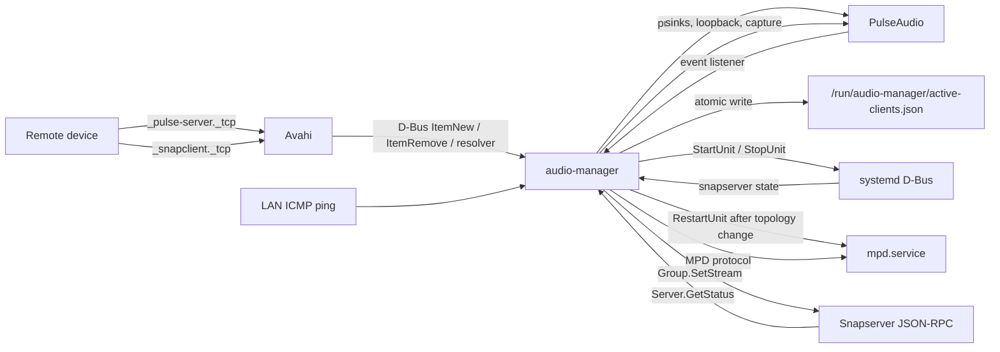
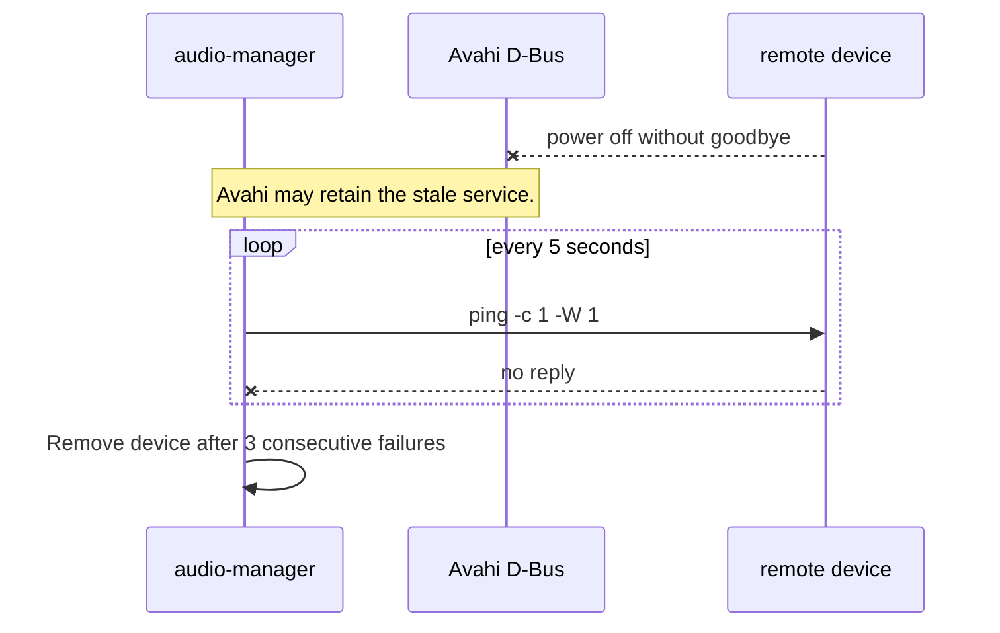
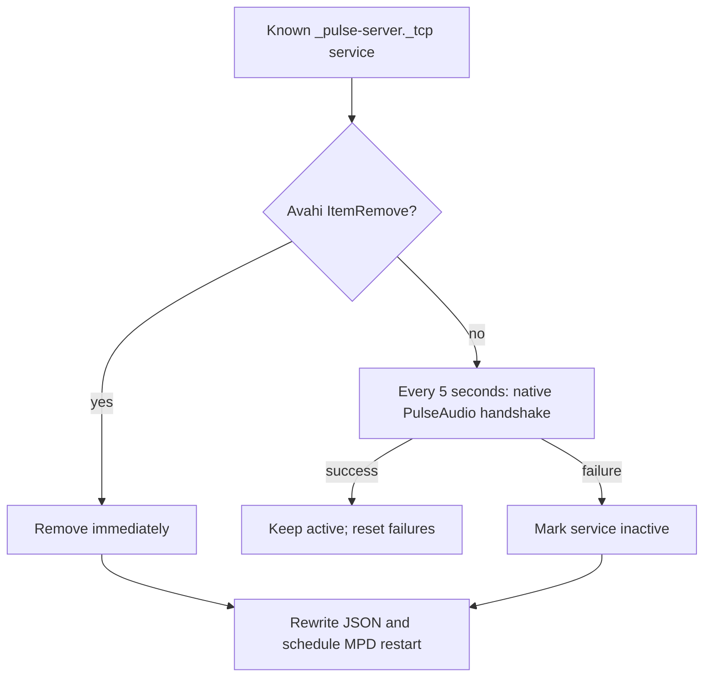
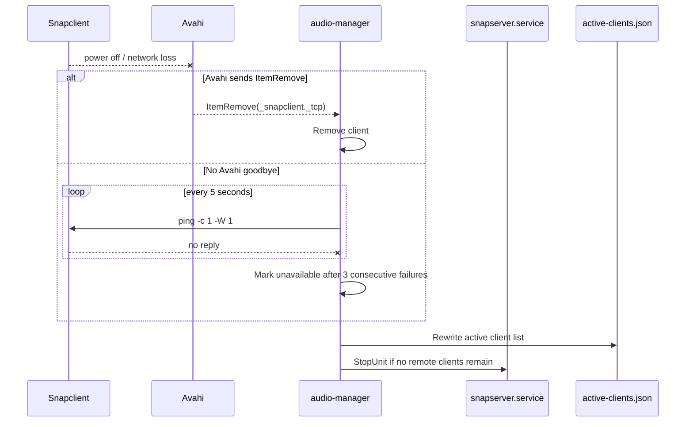
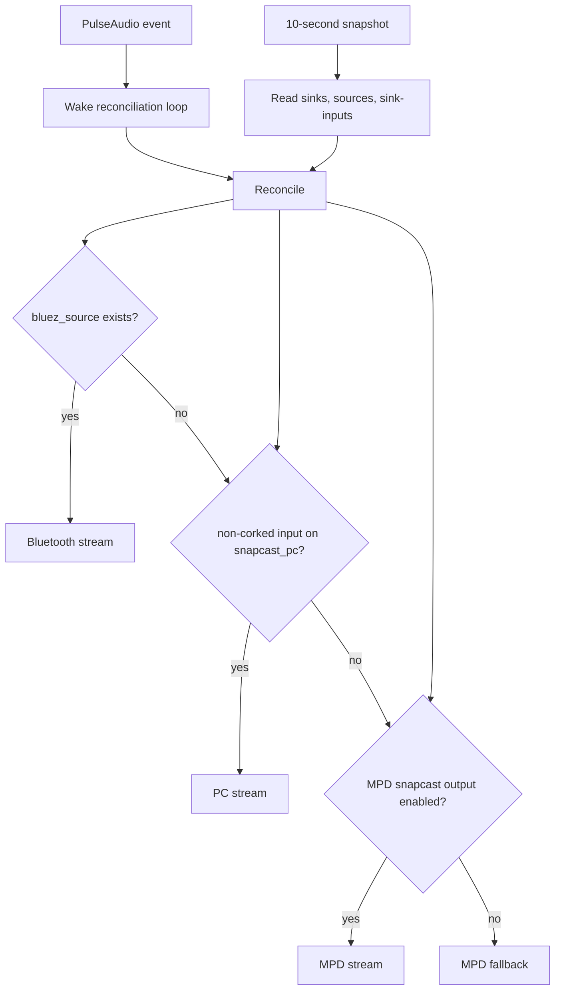
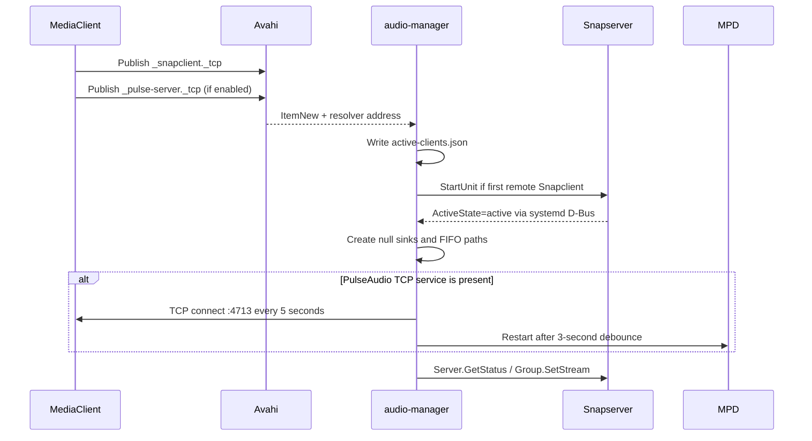

# Audio Manager

`audio-manager` coordinates Bluetooth, PulseAudio, MPD, and Snapcast on the
MediaServer. It is installed as `audio-manager.service` and runs continuously,
including when `snapserver.service` is stopped.

The manager does not use the built-in Raspberry Pi Bluetooth controller for
audio routing. It operates on the Bluetooth adapter and PulseAudio sinks and
sources available on the target system, including an additional USB adapter.

## Responsibilities

The manager is responsible for:

- discovering remote PulseAudio servers and Snapclients with Avahi;
- maintaining `/run/audio-manager/active-clients.json`;
- starting and stopping `snapserver.service` according to remote Snapclient
  presence;
- routing Bluetooth and PC audio into Snapcast FIFO streams;
- detecting whether MPD's `snapcast` output is enabled;
- selecting the active Snapcast stream for all Snapcast groups;
- stopping idle Bluetooth and PC capture processes after 60 seconds;
- requesting MPD configuration regeneration when remote PulseAudio topology
  changes.

## Code structure

The executable is an orchestration layer; audio operations are separated into
small components:

- `pulse_audio.py` — `PulseAudioRouter`, `BluetoothRoute`, and
  `CaptureProcessManager`; it owns sink creation, Bluetooth loopback, FIFO
  creation, `parec`, and PulseAudio event listening;
- `monitoring.py` — `MonitoringInterface`, `PingMonitor`,
  `PulseAudioMonitor`, and `SnapcastMonitor`;
- `monitor_coordinator.py` — monitor deadlines, device availability, and
  PulseAudio/Snapclient state transitions;
- `snapcast_control.py` — low-level local Snapcast JSON-RPC transport;
- `snapserver_service.py` — Snapserver ActiveState, `Server.GetStatus`,
  client addresses, lifecycle decisions, and group stream synchronization;
- `mpd_control.py` — `MpdService`, MPD connection, `snapcast` output-state
  checks, and debounced MPD restarts;
- `service_discovery.py` — systemd and permanent Avahi `ItemNew`/
  `ItemRemove` listeners;
- `audio-manager.py` — application lifecycle, device state, and source
  selection policy.

The Bluetooth and FIFO components are created once and remain available for
the lifetime of `audio-manager`; only their routing and `parec` processes are
reconciled when the relevant source becomes active.

`client_state.py` contains `ActiveClientsStore`, which owns the
`active-clients.json` schema, validation, atomic writes, and reads. The
controller does not construct or serialize JSON directly.

## Service lifecycle

The service is started by systemd. Before the Python process starts, the unit
executes:

```text
bluetoothctl discoverable on
```

This makes the MediaServer discoverable to Bluetooth clients. The manager then
starts its PulseAudio event listener, systemd listener, and Avahi discovery.

The manager itself remains running when Snapcast is disabled. The remote
Snapclient list controls `snapserver.service` independently:

```text
at least one remote Snapclient  -> snapserver.service active
no remote Snapclients            -> snapserver.service stopped
```

The local MediaServer Snapclient is excluded from this decision.

## Client discovery

Two Avahi service types are monitored:

```text
_snapclient._tcp
_pulse-server._tcp
```

The permanent Avahi browsers react immediately to `ItemNew` and `ItemRemove`.
There is no periodic Avahi browser or `AllForNow` reconciliation. If a device
does not send an Avahi removal, its device-level ICMP monitor handles the
stale entry.

The two service types are tracked independently. A device can therefore have
one active service and one inactive service, for example:

```json
{
  "pulse": { "active": false },
  "snapclient": { "active": true }
}
```

## Liveness checks

The reusable `MonitoringInterface` exposes a common state machine for all
checks. Each observation returns `MonitoringResult` with the current
availability, whether the state changed, and the consecutive-failure count.
Returning `None` means that no observation was possible and leaves the
previous state unchanged.

### PulseAudio

For a discovered PulseAudio service, the manager resolves its address and
performs a native PulseAudio handshake through `pulsectl`. The probe runs
every five seconds with a one-second timeout.

If the handshake fails, the PulseAudio service is marked unavailable for that
five-second monitoring cycle. A successful handshake marks it available again.
The manager then:

1. updates `active-clients.json`;
2. removes the corresponding remote MPD output on the next configuration run;
3. schedules an MPD restart after the topology-change debounce interval.

### Snapclient

Snapclient is not checked by opening TCP port `1704`. The client publishes the
Avahi service, while its health is evaluated from Snapserver's status.

When Snapserver is active, the manager queries its JSON-RPC `Server.GetStatus`
every two seconds. A client is active only when `connected` is true and its
`lastSeen.sec` is no older than five seconds. A missing client, a disconnected
client, or stale `lastSeen` marks the Snapclient service unavailable. If the
API cannot be read, the current state is retained until the next successful
observation.

The same `MonitoringInterface` state machine is used for all monitors. A
device-level `PingMonitor` is different: it sends one `ping -c 1` per check,
requires three consecutive failed checks before declaring the device
unavailable, and reports recovery on the first successful ping.

## Active-client state file

The manager atomically writes:

```text
/run/audio-manager/active-clients.json
```

The file contains the schema version, generation time, client identity,
resolved addresses, and independent PulseAudio/Snapclient status:

```json
{
  "schema": 1,
  "generated_at": "2026-10-25T13:12:35Z",
  "clients": [
    {
      "id": "MediaClientTV",
      "hostname": "MediaClientTV.local",
      "addresses": ["192.168.1.6"],
      "pulse": {
        "active": true,
        "port": 4713
      },
      "snapclient": {
        "active": true,
        "port": 1704
      }
    }
  ]
}
```

The file is runtime state and is not intended to be edited manually.

## MPD integration

`mpd-output-configurator.py` reads `active-clients.json` and updates the
auto-generated section at the end of `/etc/mpd.conf`.

Remote PulseAudio outputs are generated only for clients with
`pulse.active: true`. The Snapcast FIFO output is generated only when at least
one remote Snapclient is active:

```conf
audio_output {
    type            "fifo"
    name            "snapcast"
    path            "/tmp/snapmpdfifo"
    format          "48000:16:2"
    enabled         "no"
}
```

The FIFO is deliberately disabled by default. The user or an application can
enable it through the MPD protocol, for example:

```bash
mpc enable snapcast
```

The generated section is delimited by:

```text
# BEGIN AUTO-GENERATED MPD OUTPUTS
# END AUTO-GENERATED MPD OUTPUTS
```

User configuration outside this section is preserved. MPD is restarted after a
remote PulseAudio service is added or removed, allowing the list of outputs to
match the currently available clients.

## Audio capture and streams

Bluetooth and PC audio are captured continuously only while needed. The
manager uses these PulseAudio sinks and FIFOs:

| Input | PulseAudio sink | FIFO | Snapcast stream |
|---|---|---|---|
| Bluetooth | `snapcast_bt` | `/tmp/snapbtfifo` | `Bluetooth` |
| PC PulseAudio | `snapcast_pc` | `/tmp/snappcfifo` | `PC` |
| MPD | MPD FIFO output | `/tmp/snapmpdfifo` | `MPD` |

If Bluetooth or PC capture has no audio activity for 60 seconds, its capture
process is stopped. It is started again when activity is detected.

## Source selection

The desired source is evaluated from the current inputs:

1. Bluetooth, when a Bluetooth source is active;
2. PC, when a PC Snapcast input is active and Bluetooth is not active;
3. MPD, when the MPD `snapcast` output is enabled;
4. MPD as the fallback mode when no higher-priority source is active.

Every five seconds, and after relevant events, the manager queries Snapcast
groups. Any group whose current stream differs from the desired stream receives
`Group.SetStream`. This also corrects groups changed manually in the Snapcast
application.

When Bluetooth disconnects, the manager does not blindly choose PC. It first
checks whether PC is active; otherwise it falls back to MPD. When Bluetooth
and PC are both inactive, MPD remains the default source if its Snapcast
output is enabled.

## Useful diagnostics

Check the services:

```bash
systemctl status audio-manager.service
systemctl status snapserver.service
systemctl status mpd.service
```

Inspect the current client state:

```bash
cat /run/audio-manager/active-clients.json
```

Inspect MPD outputs:

```bash
mpc outputs
```

Inspect Avahi announcements:

```bash
avahi-browse -rt _pulse-server._tcp
avahi-browse -rt _snapclient._tcp
```

Inspect the Snapserver status:

```bash
curl -sS http://127.0.0.1:1780/jsonrpc \
  -H 'Content-Type: application/json' \
  --data '{"id":1,"jsonrpc":"2.0","method":"Server.GetStatus"}'
```

Follow manager decisions:

```bash
journalctl -u audio-manager.service -f
```

For detailed decision tracing, start the service with:

```bash
systemctl edit audio-manager.service
```

and add:

```ini
[Service]
Environment=AUDIO_MANAGER_LOG_LEVEL=DEBUG
```

Then reload and restart the service. Debug logs include Avahi events and
resolver addresses, every due ping/handshake/status check, failure counters,
`active-clients.json` writes, PulseAudio sink/capture decisions, MPD output
state, Snapcast JSON-RPC calls, source-selection decisions, and Snapserver
start/stop decisions.

Important log messages include:

- `Remote ... discovered` — Avahi found a service;
- `Remote ... removed` — Avahi sent an explicit removal;
- `Device unavailable after ... failed pings` — the device-level monitor
  reached its consecutive-failure threshold;
- `Device available again after ICMP recovery` — the device answered again;
- `PulseAudio service ...` / `Snapclient ...` — a service monitor changed
  state;
- `Restarting MPD: remote PulseAudio topology changed` — MPD output topology
  changed;
- `Active source mode: ...` — Snapcast groups were switched to a source.

## Detailed presence and audio checks

This section documents the exact checks performed by the current
implementation. Presence, PulseAudio availability, and actual audio activity
are separate states.

### Overall data flow



The manager uses a different source of information for each question:

| Question | Check |
|---|---|
| Is a service advertised? | Avahi service browser |
| Can remote PulseAudio be reached? | Native PulseAudio handshake through `pulsectl` |
| Is a device still on the LAN? | One ICMP ping per five-second check |
| Does Snapserver see the Snapclient? | `Server.GetStatus`, `connected`, and `lastSeen.sec` |
| Is audio actually active? | PulseAudio sink-input state and MPD output state |
| Which audio stream should groups use? | Source priority plus Snapcast `Group.SetStream` |

### Avahi event discovery

The manager creates permanent Avahi browsers through D-Bus for:

```text
_snapclient._tcp
_pulse-server._tcp
```

For each permanent browser it handles:

- `ItemNew` — a service appeared;
- `ItemRemove` — Avahi explicitly reported that a service disappeared;

After `ItemNew`, an Avahi resolver supplies the address. The manager stores
that address under the service name. The local MediaServer service is ignored
when deciding whether a remote Snapclient exists.

Avahi is not used as a periodic health check. If an Avahi `ItemRemove` is
missing, the separately maintained device monitor detects the problem:



### PulseAudio monitoring and what is used instead of `pactl`

The manager does not execute the `pactl` command. It imports `pulsectl` and
uses the PulseAudio native protocol directly. The command-line equivalents
are:

| Python operation | Similar manual command |
|---|---|
| `pulse.sink_list()` | `pactl list short sinks` |
| `pulse.source_list()` | `pactl list short sources` |
| `pulse.sink_input_list()` | `pactl list short sink-inputs` |
| `pulse.module_list()` | `pactl list modules` |
| `pulse.module_load()` / `module_unload()` | `pactl load-module` / `unload-module` |
| `pulse.server_info()` | `pactl info` |
| `pulse.event_listen()` | `pactl subscribe` |

This avoids starting a new `pactl` process for every check.

For a remote `pulse@MediaClientOffice` service the sequence is:

1. Avahi announces `_pulse-server._tcp`.
2. `ItemNew` adds the service name to the known PulseAudio set.
3. The resolver stores the service address.
4. Every five seconds, `PulseAudioMonitor` creates a native PulseAudio client
   for `<address>:4713`, connects with a one-second timeout, and calls
   `server_info()` as a handshake.
5. A successful handshake marks the service active; a failed handshake marks
   it inactive for that cycle.

Port `4713` proves that the remote PulseAudio server is reachable; it does not
prove that music is playing.



If a device is powered off without `ItemRemove`, the device-level ping monitor
handles the transition. The PulseAudio service is also marked inactive when
its handshake fails. The manager then updates `active-clients.json`, removes
the remote MPD output on the next configuration run, and schedules an MPD
restart with a three-second debounce.

### Snapcast: Avahi, API, and device ping

Remote Snapclients announce `_snapclient._tcp`, normally with port `1704`.
The manager uses that service for discovery but does **not** test TCP port
`1704` as a server endpoint. Snapclient is a client of Snapserver, so that
port is not used here as a reliable liveness test.

The manager obtains Snapclient addresses from both:

1. Avahi resolver results;
2. Snapserver `Server.GetStatus`, from the client's reported `host.ip`.

When Snapserver is active, `Server.GetStatus` is read over the local JSON-RPC
socket at `127.0.0.1:1705` every two seconds. The manager examines each
client's `connected` and `lastSeen.sec` fields. The API is not the discovery
source: Avahi `ItemNew` can start Snapserver when it is currently stopped.

Device reachability is checked independently every five seconds with exactly
one request:

```text
ping -c 1 -W 1 <address>
```

The subprocess has a maximum timeout of 1.5 seconds. The exit code must be
zero for the attempt to succeed. The monitor allows three consecutive failed
attempts before declaring the whole device unavailable. The threshold is set
in `Controller.__init__` as `device_ping_failure_threshold` and can be
changed to five without changing the monitor implementation. A successful
ping resets the counter and reports device recovery.

When Snapserver is active, `SnapcastMonitor` evaluates each known client on
the same two-second cadence. A client is active only when `connected` is true
and `lastSeen.sec` is less than five seconds old. If the JSON-RPC request
fails, no false negative is generated for that cycle.



When the device answers again, the ping monitor resets its failure counter,
reports recovery, rewrites `active-clients.json`, and allows Snapserver and
the service monitors to become active again.

### PulseAudio events and actual audio activity

The PulseAudio listener is event-driven and runs in a separate thread. It
subscribes through `pulsectl.Pulse.event_listen()` and wakes the main loop for
these facilities:

```text
sink-input, source, sink, card, module, server
```

This is equivalent in purpose to running `pactl subscribe`, but without
spawning the command. It reacts when, for example, an Ubuntu application moves
from `snapcast_pc` to a local speaker or when a Bluetooth source appears.

As a safety net, a complete PulseAudio snapshot is read every
`PULSE_SNAPSHOT_INTERVAL = 10` seconds:

```text
sink_list()
source_list()
sink_input_list()
```

The snapshot finds:

- a `bluez_source...` Bluetooth source;
- the `snapcast_pc` and `snapcast_bt` null sinks;
- non-corked sink inputs, which indicate active capture input.



A remote PulseAudio server can therefore be reachable while its output is
silent. Discovery and audio activity are separate states.

## Timing summary

| Operation | Interval or timeout | Purpose |
|---|---:|---|
| PulseAudio event listener | event-driven | Wake reconciliation after PulseAudio changes |
| PulseAudio state snapshot | 10 s | Safety-net read of sinks, sources, and sink-inputs |
| MPD `snapcast` output check | 5 s | Detect whether MPD selected the Snapcast FIFO |
| Snapcast group synchronization | 5 s | Correct group stream selection |
| Avahi service browser | event-driven | Receive `ItemNew` and `ItemRemove` |
| PulseAudio handshake | 5 s, `1 s` timeout | Verify native PulseAudio service |
| Snapserver status | 2 s while active, `5 s` stale limit | Verify `connected` and `lastSeen` |
| Device ping | 5 s, one `ping -c 1`, `1 s` wait, `1.5 s` process timeout | Verify LAN reachability |
| Device expiration | 3 consecutive failed pings | Avoid one transient network failure |
| systemd state fallback | 30 s | Re-read `snapserver.service` if D-Bus event was missed |
| MPD restart debounce | 3 s | Coalesce topology changes |
| Idle `parec` capture timeout | 60 s | Reduce idle CPU usage |
| Pulse event-listener retry | 2 s after failure | Recover from a temporary PulseAudio error |

## Lifecycle diagrams

### Remote client starts



### Remote client is reachable but silent

This is not a disconnect:

```text
Avahi service present
Native PulseAudio handshake succeeds (PulseAudio available)
ping responds (device reachable)
no non-corked sink-input (no current audio)
```

The client remains active in the state file and Snapserver remains available.
Only the Bluetooth/PC `parec` capture is stopped after the 60-second idle
timeout.

## Practical diagnostics

The following commands show the same information the manager consumes:

```bash
# PulseAudio state and event stream
pactl list short sinks
pactl list short sources
pactl list short sink-inputs
pactl list modules short
pactl subscribe

# Avahi publications
avahi-browse -rt _pulse-server._tcp
avahi-browse -rt _snapclient._tcp

# Generated manager state
cat /run/audio-manager/active-clients.json

# Snapserver's view of clients
curl -sS http://127.0.0.1:1780/jsonrpc \
  -H 'Content-Type: application/json' \
  --data '{"id":1,"jsonrpc":"2.0","method":"Server.GetStatus"}'

# Decisions and transitions
journalctl -u audio-manager.service -f
```

