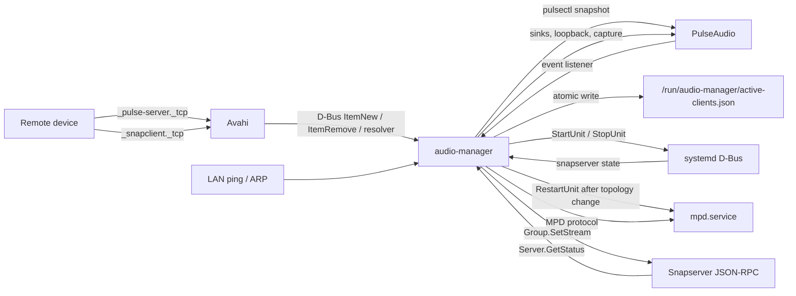
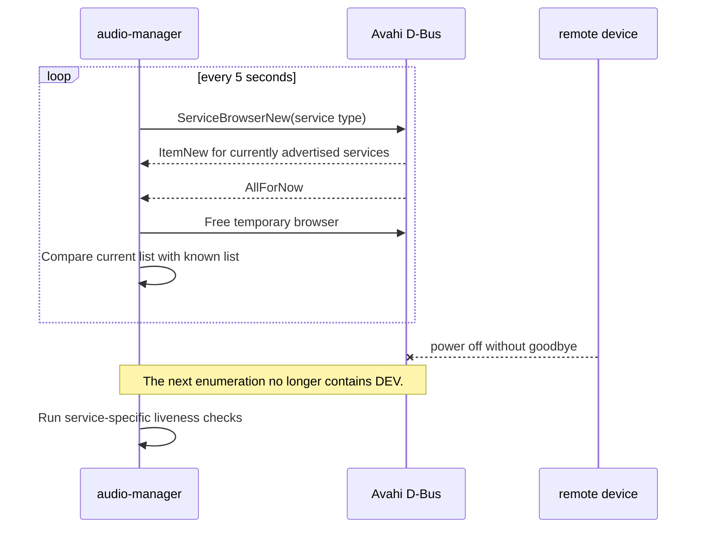
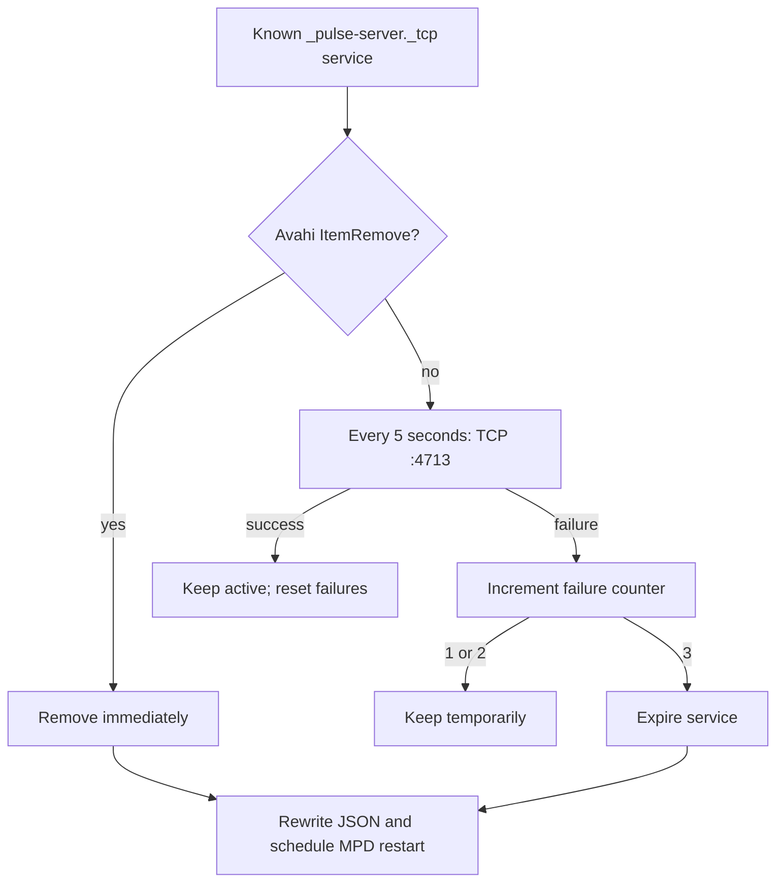
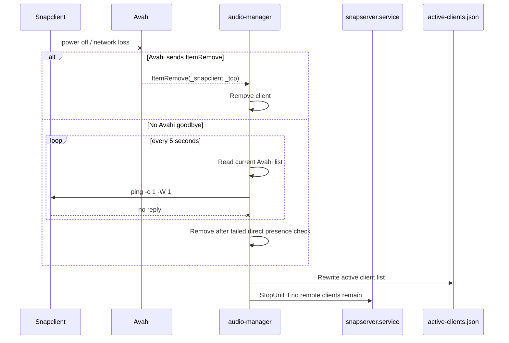
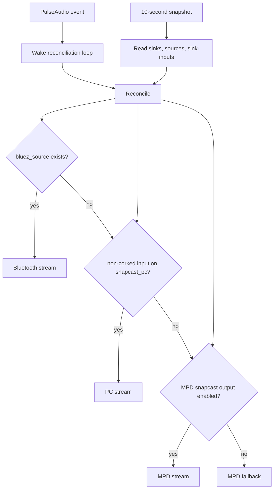
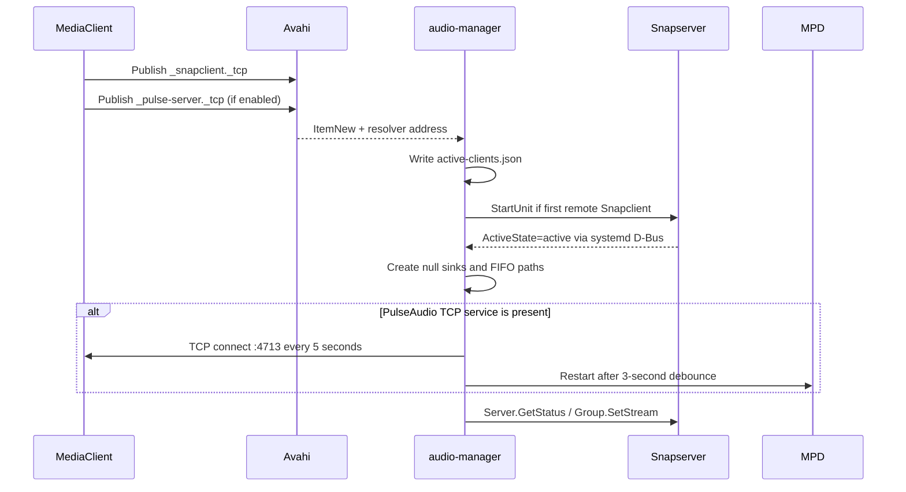

# Audio Manager

`audio-manager` coordinates Bluetooth, PulseAudio, MPD, and Snapcast on the
MediaServer. It is installed as `audio-manager.service` and runs continuously,
including when `snapserver.service` is stopped.

The manager does not use the built-in Raspberry Pi Bluetooth controller for
audio routing. It operates on the Bluetooth adapter and PulseAudio sinks and
sources available on the target system, including an additional USB adapter.

## Responsibilities

The manager is responsible for:

- discovering remote PulseAudio servers and Snapclients with Avahi;
- maintaining `/run/audio-manager/active-clients.json`;
- starting and stopping `snapserver.service` according to remote Snapclient
  presence;
- routing Bluetooth and PC audio into Snapcast FIFO streams;
- detecting whether MPD's `snapcast` output is enabled;
- selecting the active Snapcast stream for all Snapcast groups;
- stopping idle Bluetooth and PC capture processes after 60 seconds;
- requesting MPD configuration regeneration when remote PulseAudio topology
  changes.

## Service lifecycle

The service is started by systemd. Before the Python process starts, the unit
executes:

```text
bluetoothctl discoverable on
```

This makes the MediaServer discoverable to Bluetooth clients. The manager then
starts its PulseAudio event listener, systemd listener, and Avahi discovery.

The manager itself remains running when Snapcast is disabled. The remote
Snapclient list controls `snapserver.service` independently:

```text
at least one remote Snapclient  -> snapserver.service active
no remote Snapclients            -> snapserver.service stopped
```

The local MediaServer Snapclient is excluded from this decision.

## Client discovery

Two Avahi service types are monitored:

```text
_snapclient._tcp
_pulse-server._tcp
```

The permanent Avahi browsers react immediately to `ItemNew` and `ItemRemove`.
Every five seconds the manager also creates a temporary Avahi browser and
reconciles the currently known services with the current Avahi result. This
handles devices that disappear without sending a clean Avahi goodbye packet.

The two service types are tracked independently. A device can therefore have
one active service and one inactive service, for example:

```json
{
  "pulse": { "active": false },
  "snapclient": { "active": true }
}
```

## Liveness checks

### PulseAudio

For a discovered PulseAudio service, the manager resolves its address and
checks TCP port `4713`. The check uses a short timeout and succeeds when at
least one known IPv4 address accepts the connection.

If the service is present in Avahi but port `4713` does not respond, the
manager requires three consecutive failed probes before expiring the
PulseAudio service. A successful probe resets the failure counter. This avoids
removing a client because of one temporary network or PulseAudio startup
failure. The manager then:

1. updates `active-clients.json`;
2. removes the corresponding remote MPD output on the next configuration run;
3. schedules an MPD restart after the topology-change debounce interval.

### Snapclient

Snapclient is not checked by opening TCP port `1704`; the client publishes the
Avahi service but does not provide a server endpoint suitable for this probe.

When Snapserver is available, the manager additionally queries its JSON-RPC
`Server.GetStatus` method. If a known client is reported with
`"connected": false`, it is removed even if a stale Avahi announcement still
exists. If the Snapserver API is unavailable, Avahi remains the source of
truth so that a newly discovered client can cause Snapserver startup.

The periodic reconciliation also adds services that are present again in the
current Avahi result. This allows a client that was powered off and then
started again to return without restarting `audio-manager.service`.

## Active-client state file

The manager atomically writes:

```text
/run/audio-manager/active-clients.json
```

The file contains the schema version, generation time, client identity,
resolved addresses, and independent PulseAudio/Snapclient status:

```json
{
  "schema": 1,
  "generated_at": "2026-10-25T13:12:35Z",
  "clients": [
    {
      "id": "MediaClientTV",
      "hostname": "MediaClientTV.local",
      "addresses": ["192.168.1.6"],
      "pulse": {
        "active": true,
        "port": 4713
      },
      "snapclient": {
        "active": true,
        "port": 1704
      }
    }
  ]
}
```

The file is runtime state and is not intended to be edited manually.

## MPD integration

`mpd-output-configurator.py` reads `active-clients.json` and updates the
auto-generated section at the end of `/etc/mpd.conf`.

Remote PulseAudio outputs are generated only for clients with
`pulse.active: true`. The Snapcast FIFO output is generated only when at least
one remote Snapclient is active:

```conf
audio_output {
    type            "fifo"
    name            "snapcast"
    path            "/tmp/snapmpdfifo"
    format          "48000:16:2"
    enabled         "no"
}
```

The FIFO is deliberately disabled by default. The user or an application can
enable it through the MPD protocol, for example:

```bash
mpc enable snapcast
```

The generated section is delimited by:

```text
# BEGIN AUTO-GENERATED MPD OUTPUTS
# END AUTO-GENERATED MPD OUTPUTS
```

User configuration outside this section is preserved. MPD is restarted after a
remote PulseAudio service is added or removed, allowing the list of outputs to
match the currently available clients.

## Audio capture and streams

Bluetooth and PC audio are captured continuously only while needed. The
manager uses these PulseAudio sinks and FIFOs:

| Input | PulseAudio sink | FIFO | Snapcast stream |
|---|---|---|---|
| Bluetooth | `snapcast_bt` | `/tmp/snapbtfifo` | `Bluetooth` |
| PC PulseAudio | `snapcast_pc` | `/tmp/snappcfifo` | `PC` |
| MPD | MPD FIFO output | `/tmp/snapmpdfifo` | `MPD` |

If Bluetooth or PC capture has no audio activity for 60 seconds, its capture
process is stopped. It is started again when activity is detected.

## Source selection

The desired source is evaluated from the current inputs:

1. Bluetooth, when a Bluetooth source is active;
2. PC, when a PC Snapcast input is active and Bluetooth is not active;
3. MPD, when the MPD `snapcast` output is enabled;
4. MPD as the fallback mode when no higher-priority source is active.

Every five seconds, and after relevant events, the manager queries Snapcast
groups. Any group whose current stream differs from the desired stream receives
`Group.SetStream`. This also corrects groups changed manually in the Snapcast
application.

When Bluetooth disconnects, the manager does not blindly choose PC. It first
checks whether PC is active; otherwise it falls back to MPD. When Bluetooth
and PC are both inactive, MPD remains the default source if its Snapcast
output is enabled.

## Useful diagnostics

Check the services:

```bash
systemctl status audio-manager.service
systemctl status snapserver.service
systemctl status mpd.service
```

Inspect the current client state:

```bash
cat /run/audio-manager/active-clients.json
```

Inspect MPD outputs:

```bash
mpc outputs
```

Inspect Avahi announcements:

```bash
avahi-browse -rt _pulse-server._tcp
avahi-browse -rt _snapclient._tcp
```

Inspect the Snapserver status:

```bash
curl -sS http://127.0.0.1:1780/jsonrpc \
  -H 'Content-Type: application/json' \
  --data '{"id":1,"jsonrpc":"2.0","method":"Server.GetStatus"}'
```

Follow manager decisions:

```bash
journalctl -u audio-manager.service -f
```

Important log messages include:

- `Remote ... discovered` — Avahi found a service;
- `Remote ... removed` — Avahi sent an explicit removal;
- `... expired from Avahi poll` — periodic reconciliation removed a stale
  service;
- `Restarting MPD: remote PulseAudio topology changed` — MPD output topology
  changed;
- `Active source mode: ...` — Snapcast groups were switched to a source.

## Detailed presence and audio checks

This section documents the exact checks performed by the current
implementation. Presence, PulseAudio availability, and actual audio activity
are separate states.

### Overall data flow



The manager uses a different source of information for each question:

| Question | Check |
|---|---|
| Is a service advertised? | Avahi service browser |
| Can remote PulseAudio be reached? | TCP connection to port `4713` |
| Is a Snapclient still on the LAN? | ping, with ARP fallback when `ping` cannot be executed |
| Does Snapserver see the Snapclient? | `Server.GetStatus` and `connected` |
| Is audio actually active? | PulseAudio sink-input state and MPD output state |
| Which audio stream should groups use? | Source priority plus Snapcast `Group.SetStream` |

### Avahi discovery and periodic reconciliation

The manager creates permanent Avahi browsers through D-Bus for:

```text
_snapclient._tcp
_pulse-server._tcp
```

For each browser it handles:

- `ItemNew` — a service appeared;
- `ItemRemove` — Avahi explicitly reported that a service disappeared;
- `AllForNow` — the initial enumeration is complete.

After `ItemNew`, an Avahi resolver supplies the address. The manager stores
that address under the service name. The local MediaServer service is ignored
when deciding whether a remote Snapclient exists.

Avahi does not always send `ItemRemove` when a machine is powered off or loses
the network. Therefore, every `AVAHI_POLL_INTERVAL = 5` seconds the manager
creates a temporary browser, collects a fresh list, and compares it with the
known list:



`AllForNow` marks discovery as ready. PulseAudio topology changes discovered
during the initial enumeration are coalesced before an MPD restart.

### PulseAudio TCP: what is used instead of `pactl`

The manager does not execute the `pactl` command. It imports `pulsectl` and
uses the PulseAudio native protocol directly. The command-line equivalents
are:

| Python operation | Similar manual command |
|---|---|
| `pulse.sink_list()` | `pactl list short sinks` |
| `pulse.source_list()` | `pactl list short sources` |
| `pulse.sink_input_list()` | `pactl list short sink-inputs` |
| `pulse.module_list()` | `pactl list modules` |
| `pulse.module_load()` / `module_unload()` | `pactl load-module` / `unload-module` |
| `pulse.server_info()` | `pactl info` |
| `pulse.event_listen()` | `pactl subscribe` |

This avoids starting a new `pactl` process for every check.

For a remote `pulse@MediaClientOffice` service the sequence is:

1. Avahi announces `_pulse-server._tcp`.
2. `ItemNew` adds the service name to the known PulseAudio set.
3. The resolver stores the service address.
4. On each Avahi reconciliation, the manager attempts a TCP connection to
   `<address>:4713` with a `0.5` second timeout.
5. One successful IPv4 address is enough to keep the service reachable.
6. A successful probe resets the consecutive-failure counter.

Port `4713` proves that the remote PulseAudio server is reachable; it does not
prove that music is playing.



If a device is powered off without `ItemRemove`, PulseAudio normally expires
after three failed probes, roughly 10–15 seconds after the first failed
five-second cycle. A clean Avahi removal is faster. The manager then updates
`active-clients.json`, removes the remote MPD output on the next configuration
run, and schedules an MPD restart with a three-second debounce.

### Snapcast: Avahi, API, ping, and ARP

Remote Snapclients announce `_snapclient._tcp`, normally with port `1704`.
The manager uses that service for discovery but does **not** test TCP port
`1704` as a server endpoint. Snapclient is a client of Snapserver, so that
port is not used here as a reliable liveness test.

The manager obtains Snapclient addresses from both:

1. Avahi resolver results;
2. Snapserver `Server.GetStatus`, from the client's reported `host.ip`.

When Snapserver is available, `Server.GetStatus` is read over the local JSON-RPC
socket at `127.0.0.1:1705`. The manager examines each client's `connected`
field. The API is not the only discovery source: Avahi discovery can start
Snapserver when Snapserver is currently stopped.

Every five seconds known Snapclient addresses are checked with:

```text
ping -c 1 -W 1 <address>
```

The subprocess has a maximum timeout of 1.5 seconds. One responding address is
enough to keep the client reachable. If `ping` cannot be executed at all, the
manager falls back to `/proc/net/arp` and accepts a complete ARP entry.

There is a deliberate distinction in the current code:

- the direct five-second presence path can remove a known Snapclient after its
  first failed network check;
- the separate Avahi-list reconciliation has a three-failure grace counter.

Therefore the fastest effective Snapclient removal is the direct ping path.
This is different from PulseAudio, where port `4713` needs three consecutive
failed probes before expiration.



When the device is started again, `ItemNew` or the next five-second Avahi
enumeration adds it back, its address is resolved, `active-clients.json` is
rewritten, and Snapserver is started if no other remote client keeps it active.

### PulseAudio events and actual audio activity

The PulseAudio listener is event-driven and runs in a separate thread. It
subscribes through `pulsectl.Pulse.event_listen()` and wakes the main loop for
these facilities:

```text
sink-input, source, sink, card, module, server
```

This is equivalent in purpose to running `pactl subscribe`, but without
spawning the command. It reacts when, for example, an Ubuntu application moves
from `snapcast_pc` to a local speaker or when a Bluetooth source appears.

As a safety net, a complete PulseAudio snapshot is read every
`PULSE_SNAPSHOT_INTERVAL = 10` seconds:

```text
sink_list()
source_list()
sink_input_list()
```

The snapshot finds:

- a `bluez_source...` Bluetooth source;
- the `snapcast_pc` and `snapcast_bt` null sinks;
- non-corked sink inputs, which indicate active capture input.



A remote PulseAudio server can therefore be reachable while its output is
silent. Discovery and audio activity are separate states.

## Timing summary

| Operation | Interval or timeout | Purpose |
|---|---:|---|
| PulseAudio event listener | event-driven | Wake reconciliation after PulseAudio changes |
| PulseAudio state snapshot | 10 s | Safety-net read of sinks, sources, and sink-inputs |
| MPD `snapcast` output check | 5 s | Detect whether MPD selected the Snapcast FIFO |
| Snapcast group synchronization | 5 s | Correct group stream selection |
| Avahi service enumeration | 5 s | Detect missing `ItemRemove` and reappearance |
| PulseAudio TCP probe | Avahi cycle, `0.5 s` connect timeout | Verify port `4713` |
| PulseAudio expiration | 3 failed TCP probes | Avoid one transient failure |
| Snapclient ping | Avahi cycle, `1 s` ping wait, `1.5 s` process timeout | Verify LAN reachability |
| systemd state fallback | 30 s | Re-read `snapserver.service` if D-Bus event was missed |
| MPD restart debounce | 3 s | Coalesce topology changes |
| Idle `parec` capture timeout | 60 s | Reduce idle CPU usage |
| Pulse event-listener retry | 2 s after failure | Recover from a temporary PulseAudio error |

## Lifecycle diagrams

### Remote client starts



### Remote client is reachable but silent

This is not a disconnect:

```text
Avahi service present
TCP :4713 accepts connections (PulseAudio available)
ping responds (device reachable)
no non-corked sink-input (no current audio)
```

The client remains active in the state file and Snapserver remains available.
Only the Bluetooth/PC `parec` capture is stopped after the 60-second idle
timeout.

## Practical diagnostics

The following commands show the same information the manager consumes:

```bash
# PulseAudio state and event stream
pactl list short sinks
pactl list short sources
pactl list short sink-inputs
pactl list modules short
pactl subscribe

# Avahi publications
avahi-browse -rt _pulse-server._tcp
avahi-browse -rt _snapclient._tcp

# Generated manager state
cat /run/audio-manager/active-clients.json

# Snapserver's view of clients
curl -sS http://127.0.0.1:1780/jsonrpc \
  -H 'Content-Type: application/json' \
  --data '{"id":1,"jsonrpc":"2.0","method":"Server.GetStatus"}'

# Decisions and transitions
journalctl -u audio-manager.service -f
```

